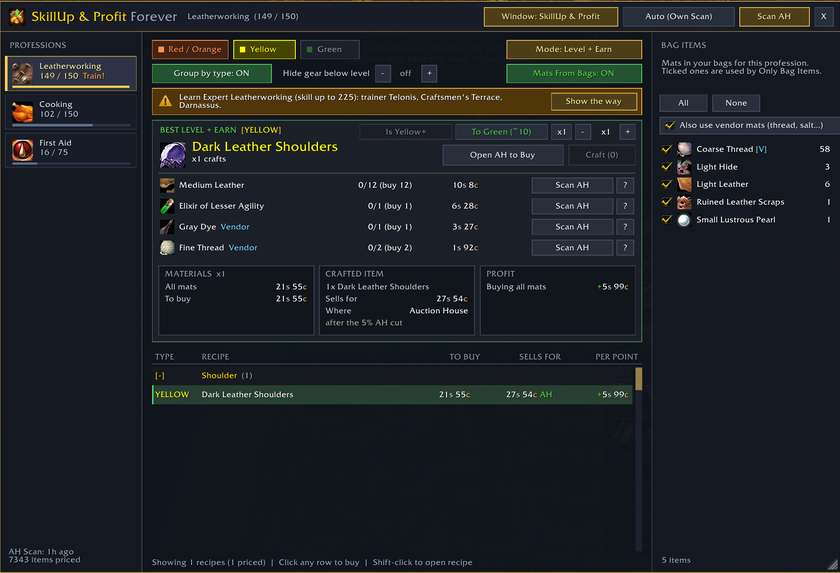

# SkillUp & Profit Forever

Level your professions the cheapest way, and earn gold doing it. Made for **WoW Forever**.

Type **/csu** or **/skillup**, or click the floating icon.

## What it does

- **Four modes** (the Mode button):
  - **Normal**: every recipe you know, A to Z.
  - **Cheapest**: the cheapest mats per skill point.
  - **Level + Earn**: skill up, and sell what you make at the vendor or on the AH, whichever pays more.
  - **Best Profit**: the most gold per craft, any colour.
- **Clear numbers**: what the mats cost, what comes from your bags and what those would sell for, what the crafted item sells for, and your profit.
- **Mats From Bags**: OFF (every mat at its price), ON (mats in your bags count as free), or **Only Bag Items** (only what you can make from the items you tick in the bag list on the right).
- **Buying**: click **Scan AH** next to a mat, and it shows the real price of the cheapest ones you need. **Buy** gets them in one click. At a vendor it buys from the vendor.
- **Groups** (Chest, Legs, Potion, Elixir...), **hide gear below a level**, and a window you can resize.
- **Next rank**: tells you when you can learn Journeyman, Expert or Artisan, and where (trainer, book or quest) for your faction. **Show the way** plans the trip, walking, flying, by boat or zeppelin, and a map pin plus an on-screen arrow (like TomTom's, no TomTom needed) point at the next stop.
- **Crafting**: craft straight from the window. Blizzard's profession window stays open but hidden; the **Window** button switches back to Blizzard's.
- **X** hides the window into the icon and keeps everything open.

Prices come from its own AH scan, or from Auctionator or CraftProfit if you use them.

## Commands

- `/csu` - open or hide the window
- `/csu scan` - scan the Auction House
- `/csu best` - print the top recipe in chat
- `/csu normal`, `/csu cheap`, `/csu earn`, `/csu profit` - pick a mode
- `/csu window` - switch between this window and Blizzard's
- `/csu ah 2|8|24` - auction length used for the AH deposit (8h by default)
- `/csu layout [classic|a|b|c|d]` - window layout (also under Options)
- `/csu scale 90` - size of the whole addon in % (also under Options)
- `/csu simple` - switch between the simple and the full window
- `/csu news` - what's new in this version
- `/csu bar` - show the crafting bar so you can move it
- `/csu queue` - open the craft queue
- `/csu bank` - count bank items as yours: on / off
- `/csu arrow` - show or hide the arrow
- `/csu reset` - put the window, icon and arrow back where they started
